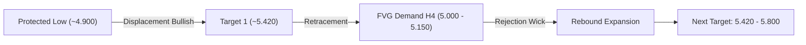

# 📊 IHSG Market Outlook & Price Action Analysis

> Analisis komprehensif pergerakan IHSG (COMPOSITE) berbasis **Smart Money Concepts (SMC)** dan integrasi sentimen makro global (**Keputusan BOJ & Penurunan Harga Minyak Mentah**).

---

## 📌 Ringkasan Eksekutif

- **Aset / Ticker**: `COMPOSITE` (IHSG - Indeks Harga Saham Gabungan)
- **Timeframe Analisis**: `4-Hour (H4)`
- **Bias**: **Bullish Rebound (Discount Zone Play)**
- **Kondisi Makro**: Sentimen *relief* global berkat kebijakan suku bunga Bank of Japan (BOJ) yang akomodatif serta penurunan harga minyak dunia.

---

## 🌐 Faktor Makroekonomi Global

### 1. Bank of Japan (BOJ) Hold Rate — Meredanya Isu *Carry Trade*
- **Konteks:** Keputusan BOJ untuk menahan suku bunga acuan (tidak menaikkan secara agresif) meredakan kekhawatiran global terkait *unwinding Yen Carry Trade*.
- **Implikasi Pasar:** Tekanan penarikan modal (*capital flight*) dari pasar berkembang (*Emerging Markets*) mereda, memberikan ruang likuiditas bagi IHSG untuk *relief rally*.

### 2. Pelemahan Harga Minyak Mentah (Crude Oil)
- **Konteks:** Premi risiko geopolitik Timur Tengah melandai dipadu perlambatan permintaan energi dari China.
- **Implikasi ke Indonesia:** Sebagai negara **Net Oil Importer**, penurunan harga minyak menguntungkan neraca dagang, menurunkan tekanan subsidi energi pada APBN, dan menjaga stabilitas Rupiah.
- **Sektor Penerima Manfaat:** Sektor Perbankan (*Big Banks*) dan *Consumer Goods*.

---

## 📈 Analisis Teknikal (SMC H4)

### Parameter & Key Levels

| Level Kunci | Rentang Harga | Deskripsi / Catatan |
| :--- | :--- | :--- |
| **Demand Zone (Entry Area)** | `5.000 – 5.150` | Area **Fair Value Gap (FVG) H4**, terdapat konfirmasi *lower wick rejection*. |
| **Invalidation (Batas Risiko)** | `< 4.900` | Di bawah **Protected Low**. Jika ditembus, skenario pantulan batal. |
| **Target 1 (TP Parsial)** | `~5.420` | Pengambilan likuiditas pada *Swing High* lokal. |
| **Target 2 (Ekspansi Utama)** | `5.400 – 5.800` | Penutupan area *imbalance* (gap besar pada chart harian/H4). |
| **Secondary Support** | `4.500 – 4.700` | Area *Order Block D1* jika skenario utama terinvalidasi. |

---

## 🎯 Rencana Eksekusi (Action Plan)

1. **Konfirmasi Reaksi:** Pantau penutupan (*closing*) candle H4 di atas level `5.050` untuk memastikan *buyer* berhasil mempertahankan area FVG.
2. **Sektor Fokus:**
   - **Perbankan:** Prospek likuiditas asing yang kembali masuk.
   - **Konsumer:** Diuntungkan oleh inflasi rendah akibat penurunan harga energi.
   - **Defensif Energi:** Waspadai volatilitas saham komoditas migas karena acuan minyak dunia yang melemah.

---

## ⚠️ Disclaimer
> Dokumen ini disusun untuk tujuan dokumentasi dan edukasi analisa pasar pribadi. Konten di dalamnya bukan merupakan rekomendasi atau ajakan untuk membeli maupun menjual instrumen keuangan apa pun. Segala keputusan investasi berada pada tanggung jawab masing-masing individu (*Do Your Own Research*).
