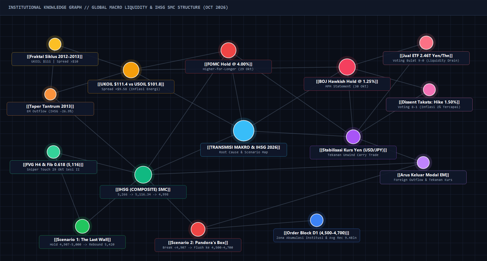
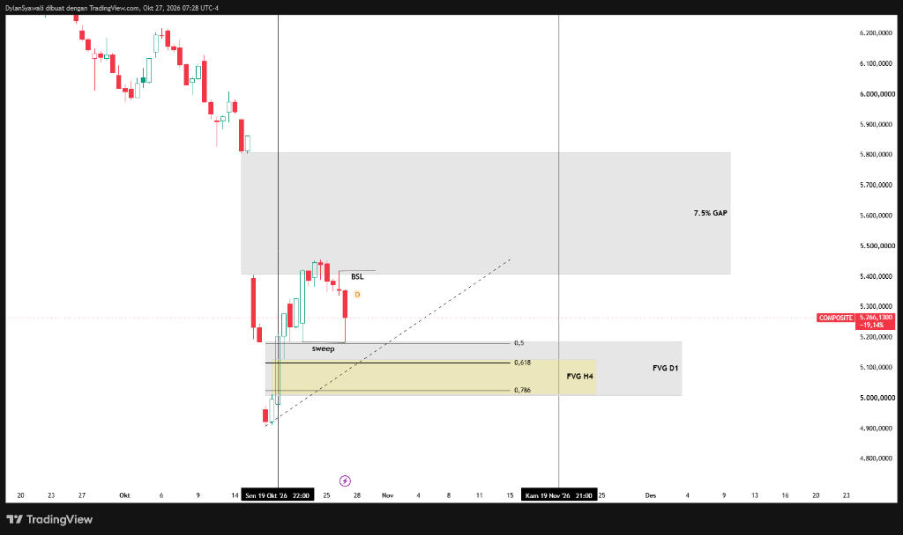
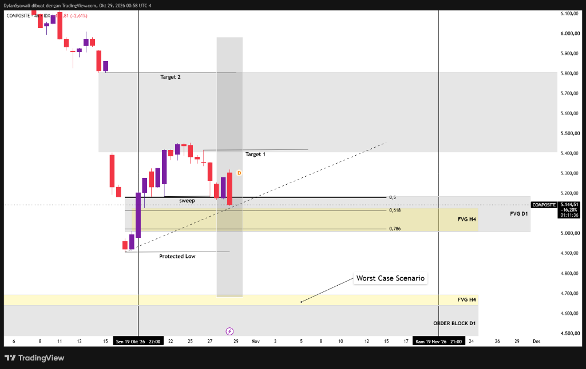
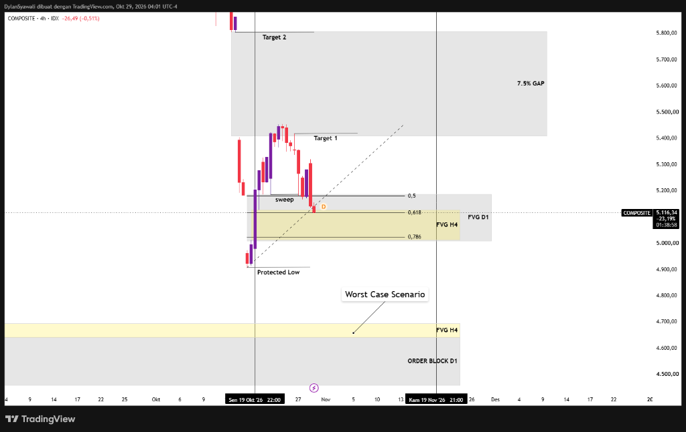

# 📊 Global Macro & Smart Money Concepts (SMC) Market Research (October 2026)

Repositori ini menyajikan **Laporan Riset Makroekonomi & Struktur Teknikal Pasar (IHSG / `COMPOSITE`)**, yang mengintegrasikan analisis kebijakan moneter bank sentral utama (**Federal Reserve / FOMC** & **Bank of Japan / BOJ**), studi kuantitatif siklus **19 tahun (2008–2026)** pada **Minyak Mentah (`UKOIL` vs `USOIL`) & Indeks Ekuitas Global**, serta pemetaan skenario eksekusi teknikal berbasis **Smart Money Concepts (SMC)**.

---

## 📄 1. Laporan Riset Utama (Full Institutional PDF Report — 6 Halaman)
Seluruh pembahasan mengenai **penyebab utama koreksi pasar di akhir Oktober 2026**, bedah dokumen resmi *Monetary Policy Statement* Bank of Japan (30 Oktober 2026), kronologi penurunan harga pada *chart* IHSG, hingga detail skenario ***"The Last Wall"*** vs ***"Pandora's Box"*** tersedia dalam satu dokumen PDF utama:

👉 **[Download / Baca Full PDF Report: `Global_Macro_and_SMC_Research_Report_Oct2026.pdf`](./Global_Macro_and_SMC_Research_Report_Oct2026.pdf)**

### Struktur Pembahasan di Dalam PDF:
* **Halaman 1 — Executive Summary & Root Cause Analysis:** 3 faktor utama pemicu penurunan harga pasar (Lonjakan `UKOIL` \$111.40–\$112.19 & anomali *spread* `>\$10`, FOMC tertahan di `4.00%`, serta kejutan *Hawkish Hold* & penjualan ETF BOJ) dilengkapi *Institutional Knowledge Graph*.
* **Halaman 2 — Mekanisme Transmisi Makro & Bedah Dokumen Resmi BOJ (30 Okt 2026):** Skema rantai transmisi kausalitas makro, disensi *hawkish* Hajime Takata (`1.50%` via *voting* 8–1), keputusan bulat (*voting* 9–0) akselerasi penjualan ETF menjadi `860 miliar Yen` nilai buku / `~2,46 triliun Yen` nilai pasar per tahun, serta mekanisme *Liquidity Drain*.
* **Halaman 3 — Anatomi Teknikal SMC IHSG (`27 – 30 Oktober 2026`):** Dokumentasi kronologis 3 fase penurunan harga dari `5,266` (*Pre-FOMC Liquidity Sweep*) -> `5,144` (*Post-FOMC Markdown* `-2.61%`) -> `5,116.34` (*Precision Tap* pada konfluensi `Fib 0.618` & `FVG H4`) -> pengujian batas bawah `FVG D1` (`~4,998`).
* **Halaman 4 — Peta Skenario Ke Depan (*Forward Scenarios*): *"The Last Wall"* vs *"Pandora's Box"*:** Bedah komprehensif parameter validasi, pemicu makro, target harga, titik pembatalan (*invalidation*), serta *Weekly Decision Matrix*.
* **Halaman 5 — Bukti Kuantitatif 19 Tahun (`2008 – 2026`): `UKOIL` (Brent) vs `USOIL` (WTI):** Tabel historis lengkap 19 tahun beserta baris `AVG TOTAL` dan analisis fraktal *spread* `>\$10` pada siklus **2012–2013 vs 2026**.
* **Halaman 6 — Benchmark Kuantitatif 6 Instrumen Global (`2008 – 2026`):** Rekapitulasi `AVG TOTAL` lintas 6 instrumen (`UKOIL`, `USOIL`, `Nikkei 225`, `S&P 500`, `NASDAQ`, `IHSG`) serta perbandingan empiris 4 siklus krisis utama (`2008 GFC`, `2020 COVID-19`, `2022 Rate Hike`, `2026 YTD`).

---

## 🧠 2. Arsitektur Transmisi Makro & Likuiditas (Institutional Knowledge Graph)
Pemetaan hubungan kausalitas antara lonjakan harga energi (`UKOIL \$111.4`), kebijakan FOMC (`4.00%`) & BOJ (`1.25%` + likuidasi ETF `2.46T Yen`), arus keluar modal *Emerging Markets*, serta struktur teknikal SMC pada IHSG:

---

## 🎯 3. Kronologi Teknikal SMC IHSG & Peta Skenario (*"The Last Wall"* vs *"Pandora's Box"*)

### A. Mengapa Harga Turun & Bagaimana Struktur SMC Merespons? (27 – 30 Oktober 2026)
1. **Fase 1 — *Pre-FOMC Liquidity Sweep & Pemetaan Area Discount* (27 Okt 2026 @ `5,266`):**
   * Kenaikan ke `5,266` pasca menyapu level *Equilibrium* `Fib 0.5` (`5,180`) meninggalkan celah inefisiensi harga pada **Kotak Kuning `FVG H4` (`5,020 – 5,115`)** dan **`FVG D1` (`5,000 – 5,115`)** yang berkonfluensi dengan area *Optimal Trade Entry (OTE)* `Fib 0.618 – 0.786`.
   
2. **Fase 2 — *Post-FOMC Markdown* (29 Okt 2026 Sesi I @ `5,144`):**
   * Keputusan FOMC menahan suku bunga di `4.00%` akibat risiko inflasi energi memicu distribusi institusi yang menekan IHSG turun `-2.61%` menuju `5,144`, mendekati batas atas `FVG H4`. Ditetapkan batas struktur **`Protected Low` (`4,907`)** serta area permintaan bawah di **`Order Block D1` (`4,500 – 4,700`)**.
   
3. **Fase 3 — *Precision Tap Fib 0.618 & Tekanan Likuiditas BOJ* (29 Okt Sesi II @ `5,116.34` -> 30 Okt @ `~4,998`):**
   * Pada penutupan 29 Oktober, harga menyentuh titik presisi **`5,116.34`** (konfluensi `Fib 0.618` + batas atas `FVG H4` + garis tren diagonal). Pada 30 Oktober, keputusan BOJ menggandakan penjualan ETF menjadi `2,46 triliun Yen/tahun` memberikan tekanan lanjutan yang membawa IHSG menguji batas bawah `FVG D1` (`~4,998 – 5,000`).
   

---

### B. Dua Skenario Utama ke Depan (*Forward Market Scenarios*)

| Parameter | 🛡️ Skenario 1: *"The Last Wall"* (Bullish Defense) | 🏺 Skenario 2: *"Pandora's Box"* (Bearish Breakdown) |
| :--- | :--- | :--- |
| **Zona Kunci** | Pertahanan **`4,907` (*Protected Low*) – `5,000` (`FVG D1`)** | *Break & Daily Close* di bawah **`4,907`** menuju **`4,500 – 4,700`** |
| **Katalis Makro** | Pasar telah mem-*price-in* FOMC `4.00%` & jadwal ETF BOJ (efektif Jan 2027); saham komoditas/energi ditopang `UKOIL \$111`. | *Front-running* penyedotan likuiditas BOJ (`2.46T Yen`) & kekhawatiran kenaikan bunga BOJ ke `1.50%` memicu *outflow* EM ala *Taper Tantrum 2013*. |
| **Syarat Konfirmasi** | *Daily Close* bertahan `> 4,907` + muncul *rejection wick* & *Bullish CHoCH / MSS* (H1/H4) yang merebut kembali level `5,116`. | *Daily Close* solid `< 4,907` (*Bearish BOS*); area `4,907 – 5,020` berubah menjadi *supply / breaker block* pada saat *pullback*. |
| **Target Proyeksi** | **Target 1:** `5,266` -> **`5,420` (`BSL`)** \| **Target 2:** **`5,400 – 5,800` (`7.5% GAP`)** | *Liquidity flush* menuju **Zona Akumulasi Akhir Institusi** di **`FVG H4 & Order Block D1` (`4,500 – 4,700`)**. |

---

## 📊 4. Database Kuantitatif 19 Tahun (`2008 – 2026`): Oil & Global Stocks
* 📁 **Excel Workbook (9 Sheet + Baris `AVG TOTAL` & Sheet `Komparasi UK vs US Oil`):** [`Riset_Makro_Oil_dan_Stocks_2008_2026.xlsx`](./Riset_Makro_Oil_dan_Stocks_2008_2026.xlsx)
* 📁 **CSV Dataset (114 Baris):** [`Riset_Makro_Oil_dan_Stocks_2008_2026.csv`](./Riset_Makro_Oil_dan_Stocks_2008_2026.csv)

### Ringkasan `AVG TOTAL (2008 – 2026)` Lintas 6 Instrumen Global
| Instrumen | Avg Harga Pembukaan | Avg Return 1 Tahun (Open-to-Close) | Avg Bottom-to-ATH dlm 1 Tahun | Avg Max Drawdown | Avg Waktu Recovery ke Equilibrium |
| :--- | :--- | :--- | :--- | :--- | :--- |
| **UKOIL (Brent)** | **\$74.60** | **+6.33% / thn** (Avg Close: \$74.95) | **+92.39% / thn** (\$57.20 -> \$98.10) | **-36.13%** | **28.6 Bulan** (~597 Hari Trading) |
| **USOIL (WTI)** | **\$69.45** | **+6.46% / thn** (Avg Close: \$69.58) | **+111.29% / thn** (\$51.34 -> \$92.23) | **-38.56%** | **26.6 Bulan** (~557 Hari Trading) |
| **Nikkei 225 (N225)** | **21,503.12** | **+9.82% / thn** (Avg Close: 24,041.83) | **+40.67% / thn** (18,816 -> 26,053) | **-21.09%** | **11.8 Bulan** (~240 Hari Trading) |
| **S&P 500 (US)** | **2,839.62** | **+10.66% / thn** (Avg Close: 3,165.39) | **+35.34% / thn** (2,505 -> 3,316) | **-16.92%** | **5.5 Bulan** (~116 Hari Trading) |
| **NASDAQ (US Tech)** | **8,089.07** | **+15.20% / thn** (Avg Close: 9,314.73) | **+44.37% / thn** (6,971 -> 9,988) | **-19.33%** | **4.5 Bulan** (~94 Hari Trading) |
| **IHSG (Composite)** | **5,223.58** | **+7.03% / thn** (Avg Close: 5,350.82) | **+42.86% / thn** (4,463 -> 5,928) | **-20.01%** | **9.4 Bulan** (~191 Hari Trading) |

---

## 🗂️ Daftar File di Repositori Ini
1. 📄 [`Global_Macro_and_SMC_Research_Report_Oct2026.pdf`](./Global_Macro_and_SMC_Research_Report_Oct2026.pdf) — Laporan Riset Utama PDF (6 Halaman A4 — *Modern Dark Institutional Edition*).
2. 🏦 [`BOJ_Statement_Monetary_Policy_Oct30_2026.pdf`](./BOJ_Statement_Monetary_Policy_Oct30_2026.pdf) — Dokumen Resmi Keputusan Kebijakan Moneter Bank of Japan (30 Oktober 2026).
3. 📊 [`Riset_Makro_Oil_dan_Stocks_2008_2026.xlsx`](./Riset_Makro_Oil_dan_Stocks_2008_2026.xlsx) — Workbook Excel 9 *Sheet* (2008–2026 + Baris `AVG TOTAL` & Komparasi `UKOIL` vs `USOIL`).
4. 📄 [`Riset_Makro_Oil_dan_Stocks_2008_2026.csv`](./Riset_Makro_Oil_dan_Stocks_2008_2026.csv) — Dataset CSV Kuantitatif (114 Baris).
5. 🧠 [`obsidian_macro_graph.png`](./obsidian_macro_graph.png) — *Institutional Knowledge Graph* (Transmisi Makro & SMC).
6. 📈 [`ihsg_chart_1_oct27_setup.png`](./ihsg_chart_1_oct27_setup.png), [`ihsg_chart_2_oct29_sesi1.png`](./ihsg_chart_2_oct29_sesi1.png), [`ihsg_chart_3_oct29_sesi2_hit.png`](./ihsg_chart_3_oct29_sesi2_hit.png) — Dokumentasi Kronologis 3 Fase Chart SMC IHSG.
